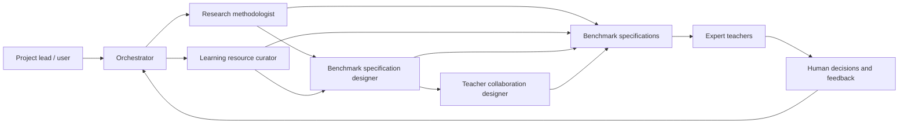
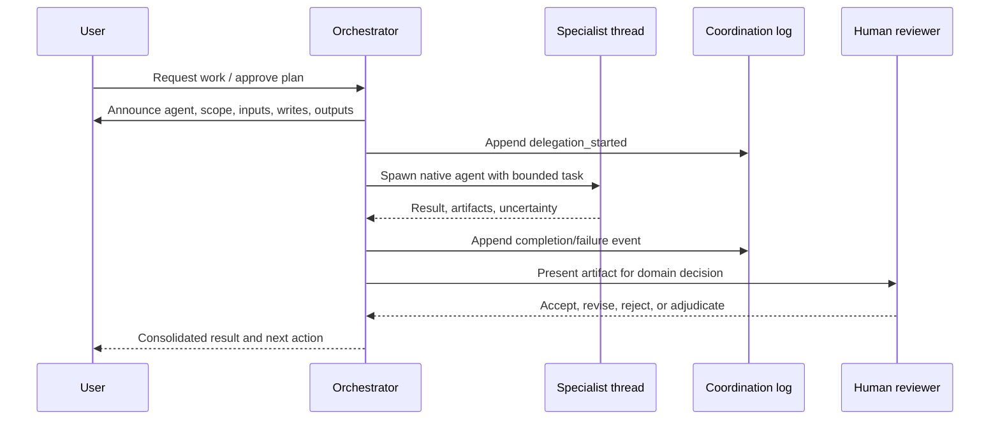

# System architecture

## Goals and principles

The system supports a human-in-the-loop research workflow for a Vietnamese lower-secondary Informatics LLM-tutor benchmark covering grades 6–9. As of 2026-07-23, grades 6–8 are part of the benchmark domain rather than only prerequisite support for grade 9. Its current architecture prioritizes:

- modular plans with explicit file ownership;
- expert-teacher authority over pedagogical and subject-matter decisions;
- canonical specialist definitions with thin runtime adapters;
- native, observable delegation instead of hidden subprocess agents;
- append-only coordination records and artifact-based handoffs;
- concise approved plan baselines with machine-readable lifecycle status;
- fail-closed or single-agent fallback when specialist activity cannot be inspected.

## Vertex requirement-scoring transport

Contract v2 tách dữ liệu thành hai lớp. `benchmark_candidate_id` và
`sample_id` là metadata điều phối do code giữ để chọn pilot, retry, resume
và join kết quả; chúng không được gửi model. User prompt gửi Vertex là một
JSON object có tám trường ngữ nghĩa: `grade`, `lesson`, `position`,
`bloom_level`, `student_prompt`, `conversation_history`,
`source_question` và `gold_answer`.

Runner serialize user prompt đúng một lần, dùng cùng chuỗi cho
`generate_content(contents=...)` và trường `user_prompt` trong record
`run_a.jsonl`/`run_b.jsonl`. Model chỉ trả sáu score; code nối candidate ID
vào normalized response. Validator tái dựng user prompt từ
`pilot_input.csv` và dừng đóng nếu chuỗi lưu không khớp.

## System context



In plain language: the user directs the orchestrator; the orchestrator delegates bounded tasks to specialists. Research and learning-resource work can proceed in parallel; benchmark specification then synthesizes both streams; teacher-collaboration work turns approved or provisional specifications into clear teacher workflows. Expert teachers review pedagogical implications; the orchestrator records and applies the human decisions.

### Human-review projection layer

Machine tables and provider payloads remain the provenance source of truth in
their approved experiment paths. When a human must edit fields or record a
decision, reusable domain code projects the minimum task-specific columns into
an `.xlsx` workbook with a stable row ID. Different decisions belong on
separate sheets; technical metadata stays in the machine artifact or a compact
provenance note. The workbook is a review interface, not a second source of
scientific truth. Writers must reopen it and verify sheets, row/ID cardinality,
editable cells, and closed-set dropdowns before handoff.

## Components and ownership

| Component | Location | Owner | Status |
|---|---|---|---|
| Canonical specialist skills | `agents/<name>/` | P01 + 20260701 Plan 01 | Implemented for six current specialists |
| Codex adapters | `.codex/agents/` | P01 | Fresh-session runtime smoke-tested |
| Claude adapters | `.claude/agents/` | P01 | Static validation; runtime deferred |
| Skill discovery links | `.agents/skills/` | P01 | Generated and validated by P01 |
| Coordination contract | `experiments/_templates/` | P01 | Implemented by P01 |
| Experiment governance v1 | `experiments/_templates/`, `src/edu_benchmark/governance/`, `scripts/governance/` | 20260806 Plan 01 | Approved baseline is the authorization surface; status YAML, chronological amendments, artifact budgets, local links, metadata, and coordination records are validated offline |
| HNMU review delivery | `src/edu_benchmark/review_delivery/`, `scripts/review_delivery/`, `experiments/20260903_135547/` | 20260903 Plan 04 + P04-A001/A004/A005 / Quân | Completed for the currently approved scope. Reusable code projects the three locked v5.6 audit exports into two protected Vietnamese workbooks with stable IDs, editable yellow cells, dropdowns and baseline provenance. A dependency-free, read-only HTTP portal serves all 5,411 staged fragments, renders 2,130 image references in Markdown context, and exposes 11 derived PDFs on demand. P04-A001 keeps fragment discovery intentionally minimal: keyword/regex plus a cascading Book → Lesson pair; the PDF tab retains its independent grade/material filters. Server-side Basic authentication reads credentials only from environment variables. The default config remains `127.0.0.1:8765`; P04-A004 adds a separate, operator-explicit `0.0.0.0:8765` feasibility config guarded by `--allow-network-bind` and external router port-forwarding. That raw-HTTP mode provides no transport encryption and is not a stable deployment contract. Missing reorganized SBT images resolve only through an explicit grade-aware OCR fallback root and remain fail-closed if absent or ambiguous. Formal teacher distribution and `shared` publication remain separate gates. |
| Python packaging and offline CI | `pyproject.toml`, `environment.yml`, `requirements.txt`, `.github/workflows/offline-tests.yml` | 20260806 Plan 02 | Src-layout editable package for Python 3.12; core/dev/provider groups are explicit; direct dependencies are pinned; Ubuntu CI runs governance plus all offline tests without credentials or provider calls |
| Shared benchmark registry | `shared/benchmark/`, `src/edu_benchmark/benchmark_registry/`, `scripts/benchmark_registry/` | 20260806 Plan 03 / 20260817 Plan 01 | Seven base bundles cover the 18-criterion checklist, 665 Phase-1 dialogues, 2,028 validated conversion candidates, the provisional 1,400/628/0 selection state, and provisional capability/principle/rubric specifications. The registry now accepts validated extension bundles such as PL-REQ v1 and preserves them across a staged rebuild of the base tree. Promotion remains idempotent and checksum-validated and does not copy raw XLSX/model JSONL or alter scientific authority. |
| PL-REQ calibration selection v1 | `experiments/20260817_160800/`, `shared/benchmark/selections/pl_req_calibration/v1/` | 20260817 Plan 01 / project lead Quân | Experiment-local code builds a 2,028-row inventory and deterministically selects 60 primary candidates plus 8 reserve with one candidate per family. Primary is 15/grade, 48 bridge candidates with all three existing target responses and 12 review-focus candidates including all eight empty provisional required sets. Model scores and fragment-length checks are stratification proxies only; Nguyên and independent pedagogical reviewers retain content/label authority. |
| Portable experiment runtime | `src/edu_benchmark/experiment_runtime/`, `experiments/20260806_145124/configs/`, `experiments/20260806_145124/runbooks/` | 20260806 Plan 04 | YAML configs contain repository-relative paths only. One fail-closed contract validates the supported pipeline, execution, input roles/formats, output schemas, parameters, and offline provenance before preflight or run. Preflight preserves an existing completed manifest and reports whether it matches the current fingerprint; validation recomputes the fingerprint and checks the recorded runtime contract before accepting the offline Section V result |
| Tầng nhà cung cấp mô hình | `src/edu_benchmark/model_providers/` | 20260806 Plan 05 / 20260902 Plan 01 | Mô-đun hạ tầng độc lập cung cấp hợp đồng yêu cầu/phản hồi/lỗi chuẩn hóa, registry lazy và implementation cho Vertex AI, OpenAI cùng Ollama native `/api/chat`. Ollama adapter mặc định chỉ cho loopback, bảo toàn role, tách thinking khỏi answer, khóa model digest và được kiểm thử bằng HTTP giả lập. Mô-đun không import workflow, không đọc artifact benchmark và không sở hữu persistence target response. |
| Provider-neutral target generation | `src/edu_benchmark/benchmark_evaluation/target_runner.py`, `src/edu_benchmark/benchmark_evaluation/performance.py`, `scripts/benchmark_evaluation/run_target_responses.py`, `scripts/benchmark_evaluation/compare_target_run_performance.py` | 20260902 Plan 02 + P02-A006/A007 | Workflow chuyển `PreparedTutorRequest` sang `ModelRequest`, gọi `ModelProvider`, chuẩn hóa target record, append JSONL/error theo attempt, fail-closed khi hash/config/model drift và resume theo candidate ID. Baseline tuần tự đã nghiệm thu 30/30. Opt-in concurrency vẫn là khả năng tổng quát có test với bounded provider workers, single-writer persistence và GPU metric theo invocation, nhưng không được dùng cho Qwen3.8/Ollama: runtime `0.32.14` ép kiến trúc `qwen35` về một slot. Config khóa source/selection/runtime nằm trong experiment; CLI không tự quản lý service. Inference thuộc quyền operator Quân. |
| Chấm yêu cầu nguyên tắc | `src/edu_benchmark/requirement_scoring/`, `scripts/requirement_scoring/`, `experiments/20260806_145124/configs/requirement-scoring-20260727-v1.yaml`, `shared/prompts/benchmark_candidate_task_assigning/` và `experiments/20260727_170150/outputs/` | 20260727 Plans 01–03 / 20260806 Plan 05 | Logic chấm, phân tích và export thuộc package nghiệp vụ; ba CLI công khai nhận config khả chuyển rồi chuyển tiếp vào package. Kết nối Vertex AI đi qua `model_providers`; namespace tạm `vertex_ai_call` đã bị loại bỏ. Workflow chỉ retry lỗi provider được phân loại có thể thử lại và phản hồi model sai lược đồ; JSONL vẫn được ghi tăng dần. P05-A003 dùng `include_thoughts=true` cho các đường Gemini hiện hành. |
| Repository hygiene inventory | `src/edu_benchmark/repository_hygiene/`, `scripts/repository_hygiene/`, `experiments/20260806_145124/configs/repository-hygiene-v1.yaml` | 20260806 Plan 06 | Config-driven, non-destructive scan records SHA-256, Git state, path-specific retention class, tracked-text references, exact duplicate groups, working-tree GitHub-limit checks, and reachable-HEAD blob checks. Detailed rows cover tracked, ignored, or explicitly targeted files; unrelated untracked files are aggregate-only so committed artifacts do not expose local paths or hashes. P06-A001 keeps payloads in their original experiment context, ignores exactly two JSONL output families without Git LFS, retains tracked snapshots/intermediates, and performs no deletion, move, untrack, externalization, or history rewrite. |
| Modular plans | `experiments/<id>/plans/` | Respective plan | Active |
| Shared raw data | `shared/raw_data/` | 20260709 Plan 02 / 20260826 Plan 01 | HNMU raw Excel inputs and manifests remain immutable. Plan 04 audit outputs cover lớp 6–7 and a separate follow-up run for lớp 8–9; the reusable normalizer emits separately traced one-row-per-sample workbooks when a later batch stores one turn per Excel row, and appends only new source records to an existing verified normalization manifest. |
| Shared learning resources | `shared/learning_resources/` | 20260709 Plan 02 layout / Plan 03 content / 20260829 Plans 01–03 + P03-A002 | SGK/SGV images, derived PDFs, registries, Nguyen OCR Markdown for SGK/SGV Tin học 6–9, SBT Tin học 6–8 lesson units, `ocr_text_manifest.csv`, `learning_resource_fragments.csv`, a rebuildable SQLite FTS retrieval index, and `agent_context/` for audit-agent navigation are available. The active manifest has 209 draft OCR units; only the 154 SGK/SGV units produce the existing 2,750 fragments, while 55 SBT units remain source-metadata-only. Grade 9 SBT remains unsupported until an approved complete source exists. Historical OCR/MinerU probes are not the primary retrieval source. |
| Full-book SBT crawler | `src/edu_benchmark/learning_resources/sbt_crawler.py`, `scripts/learning_resources/crawl_sbt_images.py` | 20260829 Plan 01 + P01-A001 | Reusable code separates the third-party discovery page from the actual NXBGD CDN content host, accepts only image URLs explicitly published in the discovery HTML under `cdnelearning.nxbgd.vn/uploads/books/`, and requires exact contiguous counts of 101/94/122 for grades 6/7/8 before downloading. It then downloads atomically, verifies image signatures/checksums, rejects old sample files or provenance, and upserts source/file registries idempotently. The CLI owns arguments, progress summary and exit-code mapping. Grade 9, URL guessing, partial-book execution and insecure TLS are unsupported. |
| Gated Datalab SBT OCR | `src/edu_benchmark/learning_resources/sbt_ocr.py`, `scripts/learning_resources/ocr_sbt_with_datalab.py` | 20260829 Plan 02 | Reusable code cross-checks the crawl manifest and both registries, verifies all 317 JPEG checksums, records deterministic inclusion/exclusion provenance, assembles 97/90/118-page PDFs, adapts the current Datalab Convert API, normalizes provider page IDs back to source-image IDs, validates extracted image references, supports grade-level resume, and publishes only eligible full-book results atomically. The CLI alone loads `.env`; API execution requires `--execute-api`, and full publication additionally requires an exact page-count confirmation. Raw responses and PDFs remain experiment-scoped. |
| Unified OCR layout and SBT lessonization | `src/edu_benchmark/learning_resources/ocr_asset_layout.py`, `src/edu_benchmark/learning_resources/sbt_lessonization.py`, `scripts/learning_resources/reorganize_ocr_assets.py`, `scripts/learning_resources/lessonize_sbt_ocr.py` | 20260829 Plan 03 + P03-A001/A002 | Reusable code inventories and rewrites local Markdown image links, stages every SGK/SGV image under its unit `images/`, locks SBT block boundaries by source/span hash, combines each exercise and solution pair into one of 53 lesson units, and renders explicit generated markers/headings for exercise versus solution without changing either OCR source span. It keeps two unwrapped table-of-contents units, rebuilds a 209-row OCR manifest while allowlisting only SGK/SGV for 2,750 fragments, and verifies zero SBT fragment/FTS rows. P03-A002 published the project-lead-selected v2 through E1/E2 with exact count/disposition flags, bundle backups, transaction journals, failure rollback, manual rollback, and successful post-validation. |
| Lossless fragment v1/v1.1 staging | `src/edu_benchmark/learning_resources/fragment_markdown_v1.py`, `scripts/learning_resources/build_learning_resource_fragments_v1.py`, `experiments/20260903_135547/` | 20260903 Plan 01 + P01-A003–A008 / Quân | V1 removes only OCR page markers, preserves canonical spans, recognizes source captions including `Bảng`, `Hình` with a complete identifier and conservative adjacent source labels, and gives each SBT exercise number its own exact section scope in both problem and solution parts. Caption ownership is one-to-one: an exact `Hình ...` shared between adjacent table candidates belongs to the previous table, while `Bảng ...` belongs to the following table. Exercise labels are inserted once, equivalent ancestor components are compacted, and heading-only tails immediately before generated SBT part boundaries remain literal text without creating false hierarchy. V1.1 measures effective Unicode characters without stripping source Markdown and uses the approved `20/1500/50/prefer_short_group` policy. It merges contiguous lineage only in the exact unit/section; structural-zero does not initiate generic merging, table-table is forbidden, and short uncaptioned tables use the length fallback only with positive-content text. Explicit structural context must precede the table; zero-effective context is eligible only when it contains a Markdown heading. Merge-contract v4, source-type lineage and lossless validation govern the derived release. The 96-row A006 CSV/A007 workbook remain immutable decision provenance. The approved staging bundle is `outputs/fragment_v1_1_v4/`: 5,411 fragments across 209 units, lossless lineage over all 5,660 v1 fragments, 228 valid `text → table` groups, and no table-table or merge-created over-cap group. Plan 01 is complete and Plan 02 may build a candidate index from this exact bundle. No shared artifact changed. |
| Unified fragment v1/v1.1 retrieval staging | `src/edu_benchmark/learning_resources/retrieval_index_v1.py`, `src/edu_benchmark/learning_resources/retrieval_api_v1.py`, `scripts/learning_resources/*_v1.py`, `experiments/20260903_135547/` | 20260903 Plan 02 + P02-A001/A002 + P03-A005 / Quân | One base table and one column-scoped FTS5 table retain section-only, content-only top-five and combined top-five search, with OR candidates/BM25 and no parent/global fallback. V1.1 input requires a lossless validation summary and recomputable merge-contract hash. Index schema v1.2 applies a deterministic eligibility gate before both tables: only rows with positive `effective_content_length` are searchable, while the source bundle remains lossless; the builder records policy/list hashes and fails if any OCR unit loses all searchable rows. Section resolution normalizes Unicode/case/punctuation and selects an ancestor prefix ending at an exact matching path component before BM25, recording the strategy in the retrieval trace. The diagnostic v1.1 SQLite remains immutable. Plan 02 completed after 71 tests and full v1.2 build/smoke validation: 3,825 base/FTS rows, 1,586 zero-effective exclusions, 209/209 units, integrity `ok`, exact-component section match and bounded in-scope top-five results. Plan 03 offline preflight has passed; model execution remains separately gated. |
| Clustered HNMU agent audit pilot | `src/edu_benchmark/data_io/dialogue_text_normalization.py`, `src/edu_benchmark/dialogue_audit/agent_audit.py`, `src/edu_benchmark/dialogue_audit/v5_input_preparation.py`, `scripts/dialogue_audit/prepare_hnmu_v5_inputs.py`, `scripts/dialogue_audit/run_hnmu_tool_calling_pilot.py`, `shared/prompts/hnmu_dialogue_audit/v1/`–`v4/`, `experiments/20260903_135547/` | 20260903 Plan 03 + P03-A001–A022 / Quân | Six fixed clusters cover exactly 18 criteria. Adapter v5 binds trusted filters/top-5 and exposes `image_placeholder_count`, Plan-01 `effective_content_length` and a criterion-neutral `image_evidence_context` alongside unchanged Markdown; it does not send image bytes. Contract v5.2 retains canonical-dialogue provenance and structured evidence bases. Resource-grounded pass for RAW-CON-01/02/03/06/07 requires a retrieved fragment; RAW-CON-03 alone may fail or remain uncertain from explicit question/dialogue evidence, while other fragment-free failures require direct internal contradiction. RAW-CON-04 requires complete core-answer coverage and RAW-STR-04 measures auditability rather than correctness. `image_dependency_candidate` stays distinct from the model's none/supporting/required decision, subjective clusters cap confidence at 0.95, and model-round traces preserve non-thought candidate content. Input preparation preserves historical IDs and namespaces 147 explicit-SBT round-2 rows. P03-A016 adds a separate fail-closed recovery boundary; P03-A017 centralizes retry classification; P03-A018 externalizes B–E prompts; P03-A019 adds bundle v2 and the human-locked targeted regression contract. P03-A020 adds prompt bundle v3, regression spec v2 with 18 criterion-level image labels, compatibility for singular/plural evidence fields, one bounded no-tool output repair, and a reserved SBT solution-section retrieval slot. P03-A021 adds bundle v4, restricts Cluster-B repair to the exact model-visible fragment projection, canonicalizes the two locked SBT section names before query signature/cache/Plan-02 search while preserving raw/effective trace arguments, and simplifies image-review routing without adding pixels. P03-A022 adds a config-only full-development run over the locked 20-sample v5 development split without changing runtime or historical outputs. Regression configs may scope clusters per sample, skip unrelated deterministic/duplicate work and publish `regression_evaluation.json`; ordinary runs retain all six clusters. Run contracts hash prompt, regression and repair-policy inputs, historical outputs remain immutable, paid execution still requires `--execute-api`, and holdout is closed. |
| Shared project package | `src/edu_benchmark/` | 20260709 Plan 02 layout; later approved plans add components | Reusable data I/O, learning-resource retrieval, dialogue audit, benchmark conversion/specification, model-provider, requirement-scoring, evaluation, experiment-runtime, registry, governance, and repository-hygiene logic is implemented under one installable package. |
| Benchmark conversion v0 | `src/edu_benchmark/benchmark_conversion/` and `scripts/benchmark_conversion/` | 20260722 Plans 01–02 | Implemented for schema validation, phase-1 evidence aggregation, hash-guarded correction overlays, pass-input joins, the legacy `final_tutor_response` pilot, and reproducible `each_tutor_turn` pilot/full conversion. Published bundles use atomic staging, explicit run status, exhaustive regex/structural validation, and raw-level `conversion_dispositions.csv`. The full pool contains 2,028 preliminary candidates from 665 pass dialogues |
| Chuẩn bị đặc tả benchmark | `src/edu_benchmark/benchmark_specification/` và `scripts/benchmark_specification/` | 20260722 Plan 03 A–C | Đã có khóa input, census/lấy mẫu xác định, mô hình sáu năng lực, schema một nhiệm vụ và sáu nguyên tắc KMP, truy vết nguồn và cơ chế đóng khi lỗi. Nhánh tám nhiệm vụ, schema chính–phụ và phương pháp v3 dùng tập nguyên tắc không thứ tự đều là legacy/chẩn đoán; chưa có nhãn nguyên tắc chính thức. Grounding pool có đủ 2.028 ứng viên và là đầu vào được kế thừa bởi experiment `20260727_170150`. |
| Thư viện rubric hai tầng | `experiments/20260727_170150/outputs/benchmark_rubric/` | 20260727 Plan 04 | Đã triển khai một task, 4 tiêu chí chung, 18 tiêu chí riêng (3 cho mỗi nguyên tắc), 6 lỗi nghiêm trọng và 29 quan hệ provenance. Rubric chung đo điều kiện nền, rubric riêng đo giá trị tăng thêm; serious error chỉ áp một lần theo `suggested_action` và không được cộng như rubric. Sáu năng lực và sáu nguyên tắc đều được bao phủ; artifact đã qua validator nhưng vẫn là provisional và cần HNMU/UET xác nhận trước khi trở thành ground truth. |
| KSE 2026 manuscript workspace | `kse_submit_manuscript/` | KSE manuscript plan | Plan approved and implementation active. `manuscript/main.tex` now contains the first Introduction and Related Work/Background draft; `references.bib` owns cited metadata, while `notes/claim_evidence_registry.csv` remains the claim–evidence control. Technical plans provide versioned paper-update packets; author metadata and PDF compilation are still pending |
| Quy trình và gói giáo viên | `experiments/20260722_000940/outputs/benchmark_specification/teacher_review_packets/` | 20260722 Plan 03 Workstreams B–D | Hiện lưu hồ sơ UET phê duyệt tạm thời sáu năng lực. Packet C1 của tám nhiệm vụ đã chuyển sang nhánh legacy và không còn chờ review. Packet HNMU hiện hành sẽ là gói tích hợp sáu năng lực–sáu nguyên tắc–rubric–ví dụ sau Workstream D. |
| Benchmark specification specialist | `agents/benchmark-specification-designer/` | 20260701 Plan 01 / P05 support | Implemented as specialist support; benchmark content remains provisional |
| Learning-resource specialist | `agents/learning-resource-curator/` | 20260701 Plan 01 | Implemented for source maps and learning-resource grounding; the active retrieval source is the registered Nguyen OCR Markdown and rebuildable local index. |
| Pedagogical-principle annotation specialist | `agents/pedagogical-principle-annotator/` | 20260722 Plan 03 Workstream C | Được giữ làm implementation lịch sử của thử nghiệm hai vòng và phục vụ truy vết chẩn đoán. Luồng requirement scoring hiện hành gọi model provider qua code cấu hình được và không dùng specialist này để chấm candidate. |
| Pipeline đánh giá phản hồi | `src/edu_benchmark/benchmark_evaluation/`, `scripts/benchmark_evaluation/`, `experiments/20260727_170150/outputs/benchmark_evaluation/` và `experiments/20260904_093529/` | 20260727 Plan 05 + 20260904 Plans 01–04 | Có native conversation transport, instruction bundle theo phiên bản và các adapter provider. Ba target lịch sử và Qwen3.8 đều có 1.400 response cùng full judge `gold-answer-only-v4` bằng Gemini/GPT. Nhánh batch bất đồng bộ dùng GCS/Vertex Batch và OpenAI `/v1/responses`; manifest, budget, collect và retry tách theo provider và thuộc quyền operator. `panel_analysis.py` ghép logic bốn target mà không ghi lại raw bundle, tính KMP score, family-macro theo rubric-eligible family size, paired family-cluster bootstrap, cross-judge agreement và audit disagreement hoàn toàn offline. |

P03-A023 does not change this component boundary: it instantiates the existing
single-cluster recovery contract for one incomplete v5.6 parent, with immutable
parent hashes and a separate child bundle.

Canonical logic belongs in `agents/<name>/SKILL.md` and its resources. Runtime adapters may configure discovery and execution but must not fork the workflow logic.

## Delegation sequence



The parent thread remains the decision surface. The user can inspect, steer, stop, or reject specialist delegation on supported runtimes.

## Observability model

Every specialist delegation has:

1. a pre-delegation announcement in the parent thread;
2. a native agent thread when the runtime exposes one;
3. append-only events conforming to `experiments/_templates/coordination-event.schema.json`;
4. a handoff based on `experiments/_templates/handoff.md`;
5. paths to inputs and outputs;
6. a summary of the orchestrator decision and unresolved questions.

Observability covers messages exposed by the runtime, tool activity, artifacts, and decisions. It does not expose or claim access to private model chain-of-thought.

Single-agent and orchestrator-only plan work uses the workflow-event branch of
the same coordination schema and a handoff with `native thread = not-applicable`.
Historical delegation events and the pre-v1 bootstrap event remain readable;
append-only logs are not rewritten just to adopt a new schema version.

## Experiment planning and governance

Experiment `20260806_145124` Plan 01 establishes the v1 governance contract:

```text
roadmap.md                          human-readable plan order and gates
plans/NN-<name>.md                 stable approved baseline
plans/NN-status.yaml               current machine-readable lifecycle
decisions/planNN-amendments.md     chronological situational decisions
runbooks/planNN*.md                exact operational procedure when needed
reports/planNN-final.md            acceptance evidence versus baseline
handoffs/planNN-*.md               next human gate
coordination/coordination_log.jsonl append-only machine events
```

Only an explicit `APPROVED` line in the baseline authorizes implementation.
Status YAML records current state but cannot self-authorize work. Amendment IDs
are allocated as decisions arise, so plans do not predict a fixed work-package
graph. Humans follow roadmap order and timeline; optional technical relationships
stay in status/coordination metadata.

The governance validator lives in `src/edu_benchmark/governance/` with a thin
CLI in `scripts/governance/`. Plan 02 removed its temporary source-path
bootstrap; the CLI now consumes the editable package like every other active
Python entry point. The default artifact budget is one baseline, status, amendment log,
runbook, final report, and handoff plus three consumed machine outputs.

Durable decisions are recorded in:

- `docs/decisions/0001-src-scripts-boundary.md`;
- `docs/decisions/0002-shared-artifact-promotion.md`;
- `docs/decisions/0003-experiment-planning-and-output-retention.md`.

## Runtime model

| Surface | Delegation policy |
|---|---|
| Codex CLI | Use native custom-agent threads; inspect and steer with `/agent`. |
| Codex App | Use native threads when agent activity is visible. |
| Codex IDE Extension | If native visibility is unavailable, fail closed or use the canonical skill in the parent thread as single-agent mode. |
| Claude Code | Keep project adapters compatible; P01 does not run Claude runtime tests. |

Nested `codex exec`, `claude -p`, shell daemons, and hidden terminal agents are prohibited for interactive delegation. Non-interactive automation requires a separate approved plan.

The project keeps specialist fan-out conservative. `research-methodologist` and `learning-resource-curator` are pinned to `gpt-5.4-mini` with medium reasoning for default Codex subagent runs. `benchmark-specification-designer` is pinned to `gpt-5.4-mini` with high reasoning for synthesis. The orchestrator must not spawn multiple copies of the same specialist for one task unless the user explicitly approves the count, rationale, model, reasoning effort, input split, write paths, and merge plan. When fan-out is approved, each branch writes separate artifacts and the orchestrator or a dedicated synthesis task performs the merge.

## Python environment

The project has one authoritative Conda environment with platform-specific executable paths:

```text
Conda environment: benchmark_env
Windows Python: D:\conda-envs\benchmark_env\python.exe
Linux Python (current server): /workspace/quannd/miniconda3/envs/benchmark_env/bin/python
```

Package installation, project scripts, validators, and tests must run with the matching `benchmark_env` interpreter for the active platform. Plan 02 adds a setuptools src-layout package: install pinned direct dependencies from `requirements.txt`, then install the repository with `python -m pip install --no-deps -e .`. Production code, scripts, and tests import only through `edu_benchmark`; they do not mutate `sys.path` or import through `src.*`. Agents must not install project packages into Conda base, system Python, or an ad-hoc virtual environment. Temporary isolated build targets are allowed only when an approved plan explicitly requires them and the authoritative validation still uses `benchmark_env`.

`environment.yml` declares Python 3.12, pip, ipykernel, the pinned direct pip
requirements, and editable project install. It is a human-maintained environment
specification, not a transitive or bit-for-bit lock. `pyproject.toml` separates
core dependencies from `dev` and `providers`; `requirements.txt` installs their
union for the full current runner. The initial GitHub Actions matrix is Ubuntu +
Python 3.12 only. CI may download dependencies during setup, but all validation
after installation is offline and receives no provider credentials. One CI lane
installs only core plus development dependencies; the other installs the full
runner and executes tests whose fixtures are tracked in Git. Data-backed tests
that require ignored raw XLSX or experiment JSONL remain local integration tests
and are not represented as clean-clone gates.

## Local-LLM runtime and cache

ADR 0004 quy định runtime theo version ở
`/workspace/quannd/local_llm_runtime/<framework>/<version>/` và cache dùng chung
ở `/workspace/quannd/local_llm_cache/`. Ollama Plan 01 dùng binary `0.32.14`,
bind `127.0.0.1:11436`, GPU UUID duy nhất, parallel/model-load bằng 1 và cache
model riêng trên `/workspace`. Launcher nằm tại
`scripts/model_providers/run_ollama_server.sh`; nó preflight, start server,
pull/resume, kiểm metadata, preload không prompt và giữ server trong một
foreground process tree có lock/log. Runtime/model payload và service log không
nằm trong Git. Service Ollama system ở port 11434 và cache system không thuộc
quyền sở hữu của component này. Vòng đời runtime Plan 01 thuộc operator: Quân
bật/tắt session `screen`; provider probe chỉ dùng endpoint đang chạy và không
tự tạo hoặc dừng service thay thế.

Plan 02 nối target-generation vào ranh giới provider chung qua
`benchmark_evaluation/target_runner.py`. Logic dùng lại sở hữu request mapping,
retry, JSONL checkpoint, resume, completion state và record validation; CLI
`run_target_responses.py` chỉ đọc config experiment, kiểm hash, tạo provider và
ánh xạ exit code. Target record giữ shape lịch sử và bổ sung `provider` cùng
`usage.cost_basis`; local Ollama ghi phí API token bằng `0.0` với cost basis
riêng, không diễn giải GPU/điện/thời gian là miễn phí. Runner không start/stop
Ollama; chỉ Quân được chủ động gọi benchmark model theo runbook.

Resource monitoring là hook tùy chọn nên không đổi hành vi các consumer cũ.
Pilot Qwen3.8 bật `resource_monitor.py` để sampling `nvidia-smi` trên đúng GPU
UUID trước, trong và sau từng request tuần tự. VRAM baseline/peak/after,
minimum free VRAM, utilization, nhiệt độ và power được checkpoint atomic trong
`run_manifest.json` theo candidate; target-response JSONL không đổi schema và
không phát sinh thêm một artifact metric riêng.
Dung lượng công bố dùng GiB với hậu tố `_gib`; MiB từ `nvidia-smi` chỉ là đơn
vị đọc nội bộ và được chia 1024 trước khi ghi artifact.

## Permissions and safety

- The orchestrator declares allowed read/write paths before delegation.
- Specialists must stay within delegated paths.
- Unsupported or unobservable delegation fails closed.
- Single-agent fallback loads the canonical skill in the parent thread without pretending that a specialist process exists.
- Existing unrelated user changes are preserved.
- Expert-teacher decisions are recorded, not silently rewritten by agents.

## Dependency direction

The historical P01 owns the original agent infrastructure and delegation contract. Experiment `20260806_145124` Plan 01 owns the current cross-experiment planning/status/amendment contract while retaining backward-compatible delegation records. The 20260701 specialist-expansion plan introduced `learning-resource-curator` and `benchmark-specification-designer`; later approved experiment plans own their scientific artifacts. The `20260806_145124` plans own repository governance, packaging, shared-artifact discovery, portable runtime, provider/code boundaries, output retention, and closeout documentation; they do not upgrade provisional benchmark content into expert-approved ground truth.

For experiment `20260709_155523`, Plan 02 owns the shared layout contract:

- `shared/raw_data/` stores unmodified raw inputs and manifests;
- `shared/learning_resources/` stores reusable SGK/SGV assets, OCR, registries, and fragments;
- `src/edu_benchmark/` stores reusable code for data I/O, audit, conversion, learning resources, and benchmark quality checks;
- `experiments/<id>/outputs/` stores run-specific derived outputs.

Plan 03 may populate `shared/learning_resources/` and its learning-resource manifest, but should not redefine the Plan 02 layout without an explicit roadmap update. As of 2026-07-18, Plan 03 Phases 0–2 have copied SGK images, crawled SGV images, created derived PDFs, and produced v0 topic/lesson/position registries for Tin học 6–9. Phase 3 OCR probes remain useful as technical evidence, but the current shared retrieval source is Nguyen OCR Markdown under `shared/learning_resources/ocr_text/`, not the old OCR/MinerU probe outputs. The agreed processed-learning-resource direction is Markdown-first: Markdown pages with front matter and stable anchors are the human-readable artifact and feed SQLite/DuckDB retrieval indexes. P03-A002 later expanded the active OCR manifest to 209 units by adding 55 SBT lesson/table-of-contents units; fragmentation and FTS remain restricted to the original 154 SGK/SGV units and 2,750 fragments. All OCR/fragment/index outputs remain `draft` until UET/HNMU review. Plan 04 and Plan 06 should add code under `src/edu_benchmark/` rather than placing reusable scripts inside experiment folders.

Experiment `20260829_175101` adds a bounded SBT ingestion extension without changing the Markdown-first retrieval source. P01-A001 retires the sample-only Taphuan path and limits the active crawler to complete SBT page sets for grades 6–8. The reusable module owns HTML parsing, discovery/content provenance separation, strict NXBGD CDN URL/host/path validation, exact page-count validation, atomic downloads, checksum verification and idempotent registry merging; the thin script owns CLI arguments, progress summary and exit codes. It only accepts page URLs actually published in the grade-specific discovery HTML and never guesses grade-9 URLs. Generated SBT source rows, page rows and crawl manifests remain `draft`, use an internal-research access policy pending rights review, and do not enter OCR/fragments automatically.

The same experiment's approved Plan 02 adds a provider-gated full-book OCR
extension. It preserves all 317 source images and records why 12 edge pages are
excluded from the derived PDFs; the OCR scope is 305 pages. PDF/raw/normalized
run artifacts remain under `outputs/datalab_ocr/<run_id>/`. The package owns
validation, assembly, Datalab adaptation, normalization, resume, and atomic
publication; the CLI owns selection arguments and secret loading. Page markers
in published Markdown use the original source-image number. Only full-book
output can enter `shared/learning_resources/ocr_text/`, always as `draft` with
internal-research access pending rights review. Expert content confirmation,
fragment generation, and retrieval indexing require separately reviewed work;
Plan 03 now owns the completed lesson-level structural publication.

Approved Plan 03 adds a staging-first migration layer without changing the
scientific authority of any OCR content. `ocr_asset_layout` owns safe local-link
parsing, nested `images/` migration, deterministic downstream rebuilds, bundle
transactions and rollback. `sbt_lessonization` owns hash-locked block boundaries,
exercise/solution pairing, per-lesson image copying and draft provenance. Thin
CLIs only parse commands and confirmation gates. P03-A002 published the
validated v2 target through atomic E1/E2 transactions: the active shared tree
now has 209 OCR units and a 209-row manifest, every unit uses nested `images/`,
and all 53 SBT lessons expose generated exercise/solution headings outside
immutable OCR source spans. Fragmentation remains explicitly allowlisted to
SGK/SGV, preserving 2,750 IDs and zero SBT fragment/FTS rows. Both publication
journals retain rollback backups under their run directories.

The PaddleOCR, VietOCR, and MinerU extraction implementations were unsuccessful
local prototypes rather than supported repository components. Their code,
tests, and environment manifests remain ignored in the project lead's local
workspace for historical reference and are deliberately excluded from package,
CI, and clean-clone guarantees. The tracked learning-resource runtime begins at
the Nguyen OCR Markdown manifest and provides deterministic fragmentation and
retrieval. The Datalab SBT runtime is the separately approved exception and has
tracked dependencies plus offline fake-provider tests; it does not reactivate
the historical local prototypes.

Plan 04 adds deterministic dialogue-audit tooling under `src/edu_benchmark/data_io/` and `src/edu_benchmark/dialogue_audit/`, with a CLI in `scripts/dialogue_audit/`. The completed Plan 04 v0 lớp 6–7 run writes under `experiments/20260709_155523/outputs/hnmu_dialogue_audit/`. A separate explicit follow-up audit for lớp 8–9 now writes under `experiments/20260709_155523/outputs/hnmu_dialogue_audit_grade8_9/`, with its 3-shard specialist checklist output under `agent_shard_audit/`. In each merged agent-audit output, `quality_check_suggestions.csv` is the main sample-level review file and uses the canonical `quality_decision` labels `pass`, `need_human_review`, and `failed`; `raw_dialogue_checklist_results*.csv` remains the detailed criterion-level source of truth. The audit is a v0 mechanical/retrieval/agent-assisted pass, not final HNMU/UET subject-matter adjudication. Experiment `20260826_174206` adds `data_io.dialogue_normalization` and a thin `scripts/dialogue_audit` CLI for a separate lossless derived-workbook path: it groups only by explicit vertical `STT` spans, joins every non-empty cell of one logical field verbatim in row order, rejects unassigned content, hashes the raw source before/after, verifies each written output cell after reopening the workbook, and can append only a previously unrecorded source result to a compatible manifest.

Experiment `20260722_000940` Plan 01 adds the deterministic conversion layer under `src/edu_benchmark/benchmark_conversion/`, with thin CLIs under `scripts/benchmark_conversion/`. It joins normalized raw rows, sample-level quality decisions, and the detailed checklist without modifying inherited snapshots. The conversion input keeps phase-1 blocking evidence separate from the union of all criterion-level evidence. Its pilot strategy uses the initial student turn as `student_prompt`, intermediate turns as structured `conversation_history`, and the final AI turn as `gold_response`; `answer_sgv` becomes `gold_answer`. Project-lead-approved corrections are stored separately with source-dialogue hashes: `raw_dialogue` remains immutable provenance, while `conversion_dialogue` is the effective text and `dialogue_correction_ids` records applied decisions.

Plan 02 implements the versioned `each_tutor_turn` contract: every AI turn becomes a target response, the initial student turn remains the fixed prompt, and only the prefix between that prompt and the target becomes history. Suffix turns are excluded from candidate content, including the last student turn in dialogues that end with `HS`. A 20-dialogue migration pilot passed before the full run produced 2,028 candidates from all 665 pass inputs with zero blocking errors. The candidate CSV intentionally contains only 10 content/key columns; source paths, correction IDs, and target turn indices live in a separate one-to-one trace table, and raw-level conversion outcomes live in `conversion_dispositions.csv`. Before publication, the pipeline serializes the entire bundle into a sibling staging directory, regex-parses all `HS:/AI:` turns, verifies every candidate/trace/disposition mapping, writes `run_status.json`, and atomically swaps the complete directory into place. A failed rerun publishes only failure status and errors, so stale candidate files cannot remain at the active output path. Candidates sharing a `sample_id` form a family that downstream data splits must keep together. Plan 03 owns task/rubric assignment and disposition; Plan 04 owns candidate evidence and quality audit.

Workstreams A–B của experiment `20260722_000940` bổ sung tầng đặc tả từ nền tảng đo lường và công bố mô hình sáu năng lực sau khi kiểm khả năng quan sát, đủ 15 cặp ranh giới và truy vết nghiên cứu. UET phê duyệt tạm thời sáu năng lực làm nền rubric, không phải xác nhận HNMU. Grounding pool có 2.028 dòng, 665 family và không chứa `gold_response`. Các phương pháp C cũ—tám nhiệm vụ, chính–phụ, tập nhãn không thứ tự và giao thức hai vòng—đều được bảo toàn làm legacy/chẩn đoán; không có nhãn nguyên tắc chính thức. Experiment `20260727_170150` là chủ sở hữu active của bước kế tiếp. Plan 01 đã khóa đặc tả một lượt grounding, trong đó system prompt tiếng Việt tại `shared/prompts/benchmark_candidate_task_assigning/` nhận context, `source_question` và `gold_answer` để chấm đủ sáu `requirement_score`. Contract V4 giữ schema V2 nhưng bắt buộc điểm `4`–`5` nêu nhu cầu độc lập và hệ quả khi bỏ nguyên tắc; Feedback và Questioning có cổng riêng. Hai calibration cho thấy Gemini 3.5 cải thiện expected range nhưng kém ổn định A/B; UET quyết định đóng calibration ở mức chẩn đoán và chạy một lần trên full pool. Full run dùng `gemini-3.5-flash`, không gửi `temperature`, `top_p`, `top_k` hoặc `thinking_budget`, dùng `thinking_level=MEDIUM`, `include_thoughts=false`, `max_output_tokens=4096`, seed `20260727`, concurrency 20 và bundle `full_gemini35_medium_v1`. Hai candidate lỗi sau lượt chạy chính được lệnh `retry-failed` chạy bù mà không gửi lại 2.026 candidate đã thành công; bundle cuối có 2.028 record duy nhất và 12.168 score. Plan 03 đã phân tích bundle bằng code, ghi ba artifact tinh gọn và evidence registry KSE: 1.400 candidate `eligible_without_plan03_review`, 628 `needs_uet_review`, 0 `blocked`. Cờ lớn nhất là 592 trường hợp Feedback điểm cao nhưng rationale chỉ chứng minh nhu cầu xác nhận/khen, chưa chứng minh hướng cải thiện; đây là cờ regex chờ UET disposition, không phải tự động sửa score. Full run vẫn không cho phép báo agreement hoặc accuracy. Nếu sau này dùng rubric riêng theo nguyên tắc, tập bắt buộc phải được đưa công khai vào instruction của tutor để tránh yêu cầu ẩn. `gold_response` chỉ xuất hiện sau khi requirement, instruction và rubric đã khóa.

Plan 05 đã bổ sung transport sinh phản hồi gia sư dưới
`src/edu_benchmark/benchmark_evaluation/`. Transport không tái sử dụng
cách đóng gói JSON của requirement-scoring: `student_prompt` trở thành
message `user` đầu tiên, từng lượt `conversation_history` được giữ nguyên
ranh giới và ánh xạ `student → user`, `tutor → assistant/model`, rồi
provider adapter chuyển chuỗi message trung gian sang role native của API.
System instruction được gửi riêng; gold, rubric, evidence và metadata điều
phối không được gửi target tutor. Reusable transport thuộc
`dialogue_transport.py`, còn `provider_adapters.py` chỉ sở hữu ánh xạ SDK.
`prompt_builder.py` ghép instruction ứng viên từ bundle có phiên bản,
`costing.py` dừng trước batch có thể vượt hard cap 250 USD,
`config_builder.py` cùng `validation.py` sinh và kiểm bốn artifact tối thiểu.
CLI dưới `scripts/benchmark_evaluation/` xây cấu hình cục bộ và chuẩn bị
smoke test tối đa 10 candidate cho Gemini managed API hoặc Llama MaaS.
Runner ghi target response tăng dần vào `run_smoke.jsonl`; khi API lỗi,
nó in exception ngay qua progress display và ghi từng attempt vào
`run_errors.jsonl` gồm HTTP status/body và traceback nhưng không chứa
prompt hay credential. Lỗi 4xx không thể hồi phục dừng ngay thay vì đi
qua retry loop; lỗi quota tạm thời và 5xx vẫn dùng `max_retries`.
Smoke runner ghi JSONL tăng dần, resume, retry theo lượt, hiển thị progress
bằng `tqdm` với ETA, tốc độ, số hoàn tất và số lỗi đang chờ thử lại, đồng
thời cần cờ `--execute-api`. Cấu hình và mọi run sinh/chấm của cùng phase
được gom dưới `outputs/benchmark_evaluation/`; mỗi run dùng một thư mục
con mang `run_id`.
Nội dung instruction không nằm trong hằng số Python. Các bundle có phiên
bản nằm dưới
`shared/prompts/benchmark_tutor_response_generation/`: `v1` bảo toàn
baseline smoke đầu tiên, còn `v2` bổ sung ràng buộc trả lời cô đọng và
kết thúc trọn câu. `instruction_bundle.py` kiểm schema, thứ tự
sáu nguyên tắc, tên tiếng Việt, khuôn dựng và SHA-256. `prompt_builder.py`
dựng các khối nhiều dòng từ bundle, còn `instruction_registry.csv` chỉ là
view phục vụ review và giữ tóm tắt căn cứ cùng vị trí nguồn. Smoke manifest
và từng target response giữ version/hash bundle; resume với bundle khác
phải dừng đóng và dùng output directory mới. Các cột provenance không
được đưa vào request.
Target record lưu nguyên `system_prompt`, `user_prompt` cuối cùng và toàn
bộ `conversation_messages` có role, đồng thời giữ hash để validator đối
chiếu nội dung. `experiment_id`, `plan_id`, `pipeline_stage` và `run_id`
giữ khả năng nhận diện phase ngay cả khi record bị tách khỏi thư mục.
Provider-neutral target runner phát callback sự kiện theo candidate; CLI dùng
`tqdm` để hiển thị progress, ETA, trạng thái, latency/token và GPU metric ngắn
gọn. Full provenance không được dump ra terminal mà tiếp tục thuộc manifest;
runbook có thể mirror stdout/stderr vào log bằng `tee`.
P02-A006 bổ sung bounded concurrency ở provider-call boundary. Với
`max_concurrency > 1`, worker không ghi file; main thread là writer duy nhất cho
response/error JSONL và manifest. GPU dùng chung được đo theo toàn invocation
và lưu trong `execution_resource_observations`, không gán sai cho từng
candidate. Cấu hình tuần tự mặc định không thêm concurrency vào locked payload,
giữ tương thích hash với manifest đã sinh trước amendment.
Runner còn chuẩn hóa và lưu `finish_reason` giữa Gemini và API
OpenAI-compatible. `MAX_TOKENS`, `length` hoặc lý do không thành công khác
được ghi `needs_review`; manifest không được chuyển sang `completed`.
Smoke so sánh prompt có thể khóa đúng danh sách candidate từ manifest run
trước thay vì dựa lại vào phép lấy mẫu.
SocraticLM là provider tự triển khai riêng: `vertex_endpoint.py` sở hữu
caller `rawPredict`, còn `manage_socraticlm_endpoint.py` sở hữu build,
deploy, status và cleanup của custom vLLM endpoint. Lifecycle manifest
experiment-scoped là khóa an toàn giữa hai phần: runner chỉ gọi đúng
endpoint còn sống, đúng project/model/location và chưa quá `delete_by`.
Billing của nhánh này được ghi theo thời gian endpoint; không quy đổi giả
thành giá token. Cleanup dừng đóng khi lệnh xóa lỗi để không che giấu GPU
còn đang tính phí. Các caller Gemini và Llama MaaS không bị sửa giao thức.
Trước khi upload Model Registry resource, lifecycle manager cấp
`roles/artifactregistry.reader` ở phạm vi repository cho đúng Vertex AI
Service Agent được suy ra từ project number. Failed deployment chỉ được
resume khi chưa sở hữu model/endpoint; image đã build được kiểm tra và tái
sử dụng. Mọi lỗi gcloud giữ structured diagnostics trong manifest.
Resource name sau upload/create không được parse trực tiếp từ stdout:
lifecycle manager truy vấn lại Model Registry hoặc Endpoint Registry bằng
display name và image URI. Không có kết quả hoặc có nhiều hơn một kết quả
đều dừng đóng; resource duy nhất được phục hồi vào manifest để resume.
Ranh giới Plan 05 tái lập `required_principle_ids` trực tiếp từ đúng các
`requirement_score >= 4` rồi đối chiếu với bundle nguồn. Điểm `3` chỉ còn
là provenance chẩn đoán của Plan 02/03, không được dùng để tạo instruction,
chọn rubric, gửi judge hoặc tổng hợp điểm. Evaluation schema bắt buộc bốn
rubric chung và đúng ba rubric của mỗi nguyên tắc bắt buộc, đồng thời cấm
rubric riêng của mọi nguyên tắc ngoài tập.

Plan 05 còn bổ sung tầng chấm mù cặp phản hồi trong `judge.py`, với
transport tách biệt tại `claude_judge.py`, `gemini_judge.py` và
`openai_judge.py`, cùng CLI điều phối `run_claude_judge_smoke.py` có lựa
chọn provider. Builder v2 join candidate, gold, target output, requirement
set và fragment SGK/SGV; code chọn rubric, tráo thứ tự bằng seed và khôi
phục `Win/Tie/Lose` sau khi judge trả JSON. User prompt dùng Markdown;
fragment được nhóm theo đúng cặp tên sách–tên bài học, chỉ heading và
content đi vào request. Claude transport dùng ADC và Vertex `rawPredict`;
Gemini transport dùng native system/user qua Google Gen AI SDK và
thread-local client. OpenAI transport dùng Responses API, system/user tách
biệt, snapshot `gpt-5.4-mini-2026-03-17`, Structured Outputs nghiêm ngặt,
`store=false` và retry do runner sở hữu. API key chỉ đọc từ `src/.env`, bị
Git bỏ qua và không tham gia manifest. System prompt tiếng Việt có phiên
bản nằm dưới `shared/prompts/benchmark_response_judging/`.

Model ID, ID nội bộ và ánh xạ target–reference không đi vào request, nhưng
prompt/hash/ánh xạ và fragment ID được lưu trong record để audit. Giao diện
model chỉ dùng tên tiêu chí và tên lỗi. Code tính giao giữa rubric bị lỗi
ảnh hưởng với rubric đang áp dụng, kiểm tên rồi ánh xạ về ID. Mỗi lỗi được
đánh giá độc lập trên hai phản hồi. Hậu xử lý giữ cả raw và adjusted
criterion judgments; cổng xác định ép `Lose` khi target mắc lỗi, `Win` khi
chỉ reference mắc lỗi, và vẫn `Lose` khi cả hai mắc. Nhiều lỗi trên một
tiêu chí chỉ tạo một adjustment. CLI dùng `ThreadPoolExecutor`; mỗi worker
Gemini sở hữu client thread-local, còn số worker được khóa trong wrapper và
manifest. Mỗi exception được in ngay lên terminal bằng `tqdm.write` dưới dạng
full diagnostic gồm traceback, finish reason, partial response và usage;
chính record đó cũng được ghi tăng dần vào `run_errors.jsonl`. Cost accounting cộng cả judgment thành công và
attempt lỗi có usage; không được chỉ tính record đã parse thành công. Khi
thay đổi generation config, runner phải dùng run directory mới thay vì
resume record khác cấu hình. CLI sở hữu retry, resume, `tqdm`, JSONL tăng
dần, manifest và budget gate; logic blinding/rubric/gate không được sao chép
vào CLI.

Plan 05 hỗ trợ hai contract judge song song trên cùng builder và provider
callers. `v2` bảo toàn hành vi lịch sử có serious-error detection/gate.
`rubric-only-v3` không đọc catalog lỗi, không đưa lỗi vào system/user prompt
và yêu cầu model chỉ trả criterion judgments cùng overall judgment. Runner
chuẩn hóa record v3 về schema lưu trữ tương thích bằng
`serious_error_findings: []`, `criterion_adjustments: []` và
`adjusted_criterion_judgments == raw_criterion_judgments`. Contract version,
prompt hash và request hash ngăn resume chéo giữa v2/v3. Structured Outputs
của OpenAI được dựng động theo contract. Gemini dùng schema cấu trúc rút gọn
để tránh giới hạn độ phức tạp của Vertex, còn validator local vẫn kiểm chính
xác tên và độ phủ rubric; provider không được tự ánh xạ ID. Wrapper v3 chạy
hai provider vào các thư mục mới, resume theo `comparison_id` và đã hoàn tất
90/90 record hợp lệ cho mỗi provider mà không sửa bundle v2 hoặc target
response.

Contract `gold-answer-only-v4` mở thêm một nhánh ablation mà không thay đổi
v2/v3. Builder không đọc conversion evidence hoặc fragment registry ở nhánh
này, bỏ section học liệu khỏi request, giữ evidence IDs rỗng và ghi
`learning_evidence_included=false`. `RUB-GEN-ACC` vẫn giữ ID nội bộ nhưng có
tên/anchor hiển thị riêng dựa duy nhất trên `gold_answer`; các rubric còn lại,
blinding, provider callers, structured output, hậu xử lý và schema record
được dùng lại. Prompt hash, contract version và output directory ngăn resume
chéo. Wrapper v4 chạy cùng 90 phép so sánh cho Gemini và GPT vào hai bundle
mới; v2/v3 và toàn bộ target response là read-only provenance.
Tên tiêu chí vẫn được kiểm nghiêm ngặt; riêng v4 chấp nhận một alias đã
quan sát của `RUB-EXP-ADAPT` rồi chuẩn hóa về tên canonical. Wrapper tách
`GEMINI_MAX_OUTPUT_TOKENS` và `OPENAI_MAX_OUTPUT_TOKENS`, nên recovery có
thể tăng giới hạn một provider mà không đổi cấu hình provider còn lại.

Plan 05 bổ sung đường full judge bất đồng bộ mà không thay runner đồng bộ.
`batch_judge.py` sở hữu serialization request theo provider, parse raw
output, validator/hậu xử lý chung và cost projection; `run_batch_judge.py`
sở hữu lifecycle prepare–submit–status/watch–collect–retry. Vertex Gemini
lưu JSONL qua GCS và OpenAI dùng Batch API `/v1/responses`. Mỗi provider có
manifest và output riêng dưới một root full-batch; chỉ record lỗi được retry,
final JSONL chỉ publish `completed` khi đủ 4.200 comparison đúng hash. Budget
Gemini và OpenAI không được cộng chung: mỗi nhánh dùng pilot-v4 p95 theo đơn
giá batch, stage cap và remaining budget riêng. Recovery full run cho phép
chuẩn hóa cục bộ duy nhất các alias tên tiêu chí đã quan sát và ánh xạ chính
xác về tên canonical; các tên không biết vẫn fail closed. Giới hạn token gốc
được giữ trong fingerprint, còn `retry-max-output-tokens` chỉ áp dụng và được
ghi provenance cho attempt retry mới. Full run hiện đã hoàn thành
4.200/4.200 judgment cho từng judge; attempt cuối của Gemini chỉ gửi lại hai
request `MAX_TOKENS` ở giới hạn 9.000 token.

Experiment `20260904_093529` Plan 01 mở rộng đúng lớp orchestration batch, không
đổi `judge.py` hoặc `batch_judge.py`. `run_batch_judge.py` nhận explicit
experiment ID, plan ID, pipeline stage, output root và số candidate; số target
được suy ra từ các `--target-run` duy nhất. Output vẫn bị sandbox logic vào đúng
`experiments/<id>/outputs/benchmark_evaluation/`, còn expected comparison bằng
candidate × target và đi vào fingerprint/manifest. Legacy defaults có nhánh
chấp nhận fingerprint Plan 05 cũ. Thin wrapper
`run_qwen38_judge_batch.sh` khóa Qwen target, judge models, prompt snapshot và
project nhưng mặc định offline `prepare`; chỉ action explicit khác mới thêm
`--execute-api`. Vì file prompt `shared` đang có thay đổi người dùng, Qwen flow
dùng snapshot experiment-local có đúng stripped hash `dc6b547...` của hai full
judge lịch sử, không sửa hoặc ghi đè prompt dùng chung. Plan 01 chỉ tạo batch
input/preflight; bucket mới, pilot trả phí và full run thuộc Plan 02/03. Wrapper
nhận optional `CALIBRATION_JUDGMENTS` nhưng giữ calibration lịch sử làm default;
P03-A003 dùng override này để projection OpenAI full dựa trực tiếp trên pilot
Qwen 30 mẫu mà không sao chép business logic vào experiment script. Gemini và
OpenAI vẫn có output, lifecycle và cap riêng; provider action luôn cần
`ACTION` explicit và `--execute-api` do wrapper thêm.

Section V analysis is a deterministic post-processing layer under
`src/edu_benchmark/benchmark_evaluation/section_v_ablation.py`, with the thin
compatibility CLI `scripts/benchmark_evaluation/analyze_section_v_ablation.py`.
Plan 04 moved its active defaults into
`experiments/20260806_145124/configs/section-v-ablation-v1.yaml`; the shared
runtime resolves those paths independently of CWD and records relative
provenance in a versioned manifest. It reads only the locked 1,400-candidate
pool and the two 4,200-record full judge bundles, applies paired family-cluster
bootstrap and agreement statistics, validates paper-facing anchors, then
atomically publishes one experiment-scoped result. The Plan 04 rebuild has the
same semantic SHA-256 as the historical baseline after normalizing only the
old repository-absolute provenance paths. This layer never calls model
providers and does not modify judge or target-response artifacts. A later
preflight check cannot downgrade a completed manifest. Validation rebuilds the
preflight contract from the current config, input checksums and code hashes,
then compares it with the stored fingerprint and manifest provenance before
accepting the result. Preflight and execution share the same run-blocking
contract; unsupported pipelines, invalid parameters, input-role/format drift,
output-schema drift, incompatible resume policy, or incomplete offline
provenance fail with a machine-readable command status and exit code 2.

Experiment `20260904_093529` Plan 04 adds the reusable offline extension
`panel_analysis.py` and a thin `analyze_qwen38_panel.py` CLI. It validates the
four immutable judge bundles, logically forms four targets per judge, and
publishes scores, 5,000 paired family-cluster bootstrap draws, Qwen-only
cross-judge agreement, position/metadata sensitivity, and a compact
disagreement CSV. Family-macro gives every eligible dialogue family equal
weight separately within each rubric; this reproduces all six historical
manuscript anchors. The legacy Section V result is rebuilt and must retain its
semantic SHA before new outputs are accepted. The component has no credential
or provider dependency and records `provider_calls=0`.

Later plans must not move canonical logic into runtime adapters or redefine P01 coordination semantics without an explicit architecture decision and migration plan.

## Extension points

- Add a specialist by creating one canonical skill, thin Codex/Claude adapters, tests, and an ownership declaration.
- Add a runtime by writing an adapter and observability policy without changing canonical workflows.
- Add an automated pipeline only through a separately approved non-interactive plan.
- Add architectural decisions as individual ADRs under `docs/decisions/` when the first durable cross-plan decision requires one.

## Known limitations and open decisions

- Codex IDE subagent visibility may be incomplete; CLI/App are the P01 audit surfaces.
- Claude adapters are not runtime-tested in P01.
- Coordination events are file-based and not yet backed by a database or UI.
- The governance validator implements the v1 rules directly because `jsonschema`
  is not a project dependency; JSON Schema files remain the portable contract.
- Native transcripts depend on runtime retention and do not include private chain-of-thought.
- Benchmark taxonomy, dataset schema, rubrics, selections, and evaluation results
  are implemented as provisional research artifacts, not final HNMU-approved
  benchmark content or ground truth.
- Direct Python dependencies and Python 3.12 are pinned, but a cross-platform
  transitive Conda/pip lock is not implemented. `environment.yml` is a
  specification, not a bit-for-bit lock.

Last verified against completed experiment `20260817_160800` Plan 01 on 2026-08-17. The PL-REQ selection and extension-preserving shared registry passed deterministic validation, all 309 offline repository tests passed, and the earlier clean-snapshot evidence from `20260806_145124` Plan 07 remains the latest wheel-installation validation.

### HNMU dialogue auditor specialist

`hnmu-dialogue-auditor` is a narrow Plan 04 specialist. It audits raw HNMU dialogue rows with the raw-dialogue checklist, SGK/SGV retrieval evidence, and the canonical HNMU scaffolding note. It writes criterion-level checklist rows and review suggestions; it does not edit raw Excel files, create benchmark samples, assign official tasks, or replace HNMU/UET judgment.

### Experiment-scoped v5.6 source-batch orchestration

Experiment `20260903_135547` P03-A024 owns a thin operational layer around the
existing dialogue-audit runtime. It creates derived seven-column workbooks,
one provenance-checked normalized snapshot, balanced source selections, and
per-shard configs; the shared runner still owns validation, tool calling,
checkpointing, and result semantics. A source-scoped shell wrapper sequences
preflight and paid runs without automatically crossing source boundaries. An
offline experiment-local exporter validates exact 18-criterion coverage before
producing machine CSV/JSON and a compact Vietnamese XLSX workbook. This layer
is intentionally run-specific: it adds no second audit implementation under
the experiment and does not modify raw workbooks, reusable `src/` components,
prompts, retrieval indexes, or historical model outputs.
